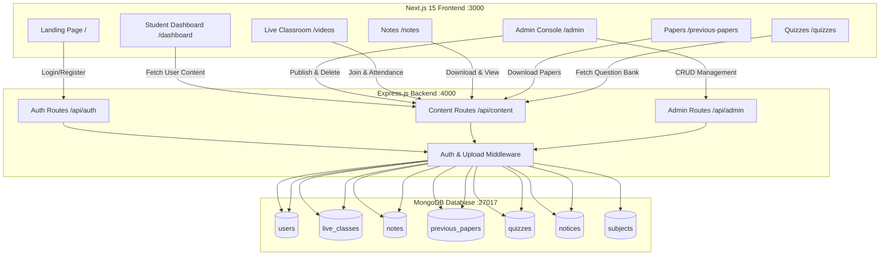
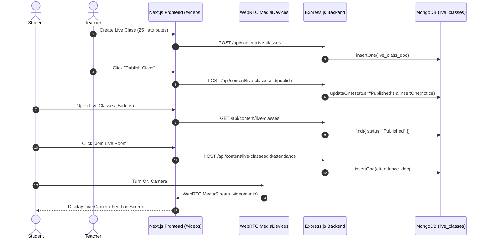

# 🎓 StudyMaterial – Full-Stack Enterprise Platform Master Documentation

A complete, production-ready Educational Management System (EMS) & Virtual Live Classroom platform built for Board Examination Preparation (Classes 10th, 11th, and 12th – Medical, Non-Medical, Commerce, and Arts).

Powered by **Next.js (React 19)**, **Express.js**, **MongoDB**, **WebRTC Video Capture**, **TypeScript**, and **Tailwind CSS**.

---

## 📑 Table of Contents

1. [🌟 Executive Architecture Overview](#-executive-architecture-overview)
2. [🗺️ Complete System Relationship & Data Flow Matrix](#️-complete-system-relationship--data-flow-matrix)
3. [💻 Frontend Page-by-Page & Component Breakdown](#-frontend-page-by-page--component-breakdown)
4. [⚙️ Backend Services, Controllers & Endpoints Mapping](#%EF%B8%8F-backend-services-controllers--endpoints-mapping)
5. [🗄️ MongoDB Database Collections Schema](#%EF%B8%8F-mongodb-database-collections-schema)
6. [📹 Real-Time Live Classroom & WebRTC Engine](#-real-time-live-classroom--webrtc-engine)
7. [📂 Complete Project Directory Structure](#-complete-project-directory-structure)
8. [🚀 Setup, Seeding & Execution Guide](#-setup-seeding--execution-guide)

---

## 🌟 Executive Architecture Overview



---

## 🗺️ Complete System Relationship & Data Flow Matrix

The matrix below shows the exact 1-to-1 mapping between **Frontend Routes**, **Rendered Components**, **Backend API Endpoints**, **MongoDB Collections**, and **Data Operations**:

| Frontend Route | UI Component | Backend API Endpoint | MongoDB Collection | Data Operation & Action |
| :--- | :--- | :--- | :--- | :--- |
| `/` | `LandingPage` (`page.tsx`) | N/A (Static SSG / ISR) | N/A | Public marketing homepage with feature highlights |
| `/login` | `LoginPage` (`(auth)/login`) | `POST /api/auth/login` | `users` | Authenticates email/password, issues JWT token & session |
| `/register` | `RegisterPage` (`(auth)/register`) | `POST /api/auth/register` | `users` | Creates student account with grade, stream & hashed password |
| `/dashboard` | `DashboardPage` (`(dashboard)/dashboard`) | `GET /api/content/progress`, `GET /api/content/notices` | `notes`, `previous_papers`, `quizzes`, `notices` | Displays student learning stats, progress widgets, and notices |
| `/admin` | `AdminPage` (`(admin)/admin`) | `GET /api/admin/dashboard`, `POST /api/content/*`, `DELETE /api/content/*` | `users`, `live_classes`, `notes`, `previous_papers`, `quizzes`, `notices` | Master Admin Console for CRUD, class publishing & user list |
| `/videos` | `VideosPage` (`(dashboard)/videos`) | `GET /api/content/live-classes`, `POST /api/content/live-classes/:id/attendance` | `live_classes`, `live_class_attendance`, `live_class_chat` | Interactive WebRTC Live Classroom, chat stream & scheduled classes |
| `/notes` | `NotesPage` (`(dashboard)/notes`) | `GET /api/content/notes` | `notes`, `downloads` | Fullscreen PDF note preview modal (`88vh x 5xl`) & download logger |
| `/previous-papers` | `PapersPage` (`(dashboard)/previous-papers`) | `GET /api/content/papers` | `previous_papers`, `downloads` | Solved board examination question paper library |
| `/quizzes` | `QuizzesPage` (`(dashboard)/quizzes`) | `GET /api/content/quizzes` | `quizzes`, `results` | Start-button controlled MCQ test engine with timers & explanations |
| `/subjects` | `SubjectsPage` (`(dashboard)/subjects`) | `GET /api/content/subjects` | `subjects` | Grade & Stream subject cards (Biology, Physics, Chemistry, Math) |
| `/notices` | `NoticesPage` (`(dashboard)/notices`) | `GET /api/content/notices` | `notices` | Platform announcements & datesheet notifications drawer |
| `/downloads` | `DownloadsPage` (`(dashboard)/downloads`) | LocalStorage / API | `downloads` | Personal history of downloaded PDF notes & solved papers |
| `/edit-profile` | `EditProfilePage` (`(dashboard)/edit-profile`) | LocalStorage / User Session | `users` | Update student profile photo avatar, username, grade & stream |
| `/settings` | `SettingsPage` (`(dashboard)/settings`) | LocalStorage / Theme Provider | `users` | Theme toggling (Dark/Light mode) & account preferences |

---

## 💻 Frontend Page-by-Page & Component Breakdown

### 1. Public Shared Components (`frontend/components/`)
- `public-navbar.tsx`: Sticky navigation bar with notifications drawer, global search trigger (`Ctrl+K`), profile avatar dropdown menu, and Admin Console link.
- `public-footer.tsx`: Footer with subject links, Quick Navigation, social links, and copyright metadata.
- `site-shell.tsx`: Main dashboard layout container providing collapsible sidebar navigation (10 Student items vs 10 Admin items), theme toggler, mobile drawer, and header stats bar.
- `global-search-modal.tsx`: Instant global search modal across all Subjects, Notes, Papers, Quizzes, Teachers, and Live Classes.
- `theme-provider.tsx`: React Context provider persisting Dark/Light mode theme state across browser reloads.

### 2. Student Dashboard (`frontend/app/(dashboard)/dashboard/page.tsx`)
- Displays **12 Dynamic Widgets**:
  1. Upcoming Live Classes Ticker
  2. Quick PDF Note Preview
  3. Solved Papers Download Module
  4. Active Quizzes with Timer
  5. Learning Progress Graph
  6. Recent Notices Drawer
  7. Grade & Stream Selector
  8. My Downloads Table
  9. Dark/Light Mode Switcher
  10. Enrolled Student Profile Summary Card
  11. Notification Alert Badges
  12. Global Search Command Launcher

### 3. Administrator Console (`frontend/app/(admin)/admin/page.tsx`)
- Master management dashboard supporting **10 Control Tabs**:
  1. **Dashboard Overview**: Real-time MongoDB metrics (Users, Students, Admins, Notes, Papers, Live Classes, Quizzes, Notices).
  2. **Users & Students**: Registered user table displaying usernames, emails, roles, grade, stream, and registration date.
  3. **Notes Management**: Directory table of uploaded PDF notes with verified MongoDB deletion.
  4. **Previous Papers**: Directory table of solved board papers with deletion controls.
  5. **Live Classes**: Complete 25+ parameter Create Form + Live Class directory table with one-click **Publish Class** workflow.
  6. **Quizzes & Tests**: Quiz bank creation and test configuration.
  7. **Notices & Announcements**: Notice publisher that broadcasts alerts to student dashboards.
  8. **Upload PDF Note**: File upload module for PDF notes.
  9. **Upload Board Paper**: File upload module for board question papers.
  10. **Publish Notice**: Instant announcement publisher.

### 4. Interactive Live Classroom (`frontend/app/(dashboard)/videos/page.tsx`)
- **WebRTC Camera Broadcast**: Local camera & microphone capture (`navigator.mediaDevices.getUserMedia`) when student/teacher turns Cam ON.
- **Live Canvas Whiteboard**: Interactive drawing board for diagram explanations.
- **Live Classroom Chat**: Real-time discussion stream with student and teacher role switches.
- **Meeting Launcher**: Direct links to open Google Meet, Zoom, Jitsi Meet, or LiveKit broadcast rooms.
- **Automated Attendance**: Logs student join timestamp into `live_class_attendance` MongoDB collection.

---

## ⚙️ Backend Services, Controllers & Endpoints Mapping

### 1. Controllers (`backend/src/controllers/`)
- `auth.controller.ts`: Handles student/admin login, registration, password reset token generation, and token signing.
- `admin.controller.ts`: Calculates real-time MongoDB aggregations for dashboard summary and retrieves registered users list.
- `content.controller.ts`: Manages CRUD endpoints for notes, papers, videos, quizzes, notices, uploads, live class creation, publishing, attendance logging, and deletion.

### 2. Services Layer (`backend/src/services.ts`)
- `getDashboardSummary()`: Runs native MongoDB `countDocuments()` and `$group` aggregations across collections.
- `listLiveClassesService()`: Filtered MongoDB query by grade, stream, subject, status, category, teacher name, and search regex.
- `createLiveClassService()`: Inserts 25+ parameter live class record into `live_classes` collection.
- `publishLiveClassService()`: Updates class status to `Published` in MongoDB and automatically creates an announcement in `notices` collection.
- `deleteLiveClassService()` & `deleteContent()`: Executes verified `deleteOne` MongoDB calls matching `ObjectId` or literal `id`.
- `logLiveAttendanceService()`: Inserts attendance record into `live_class_attendance` collection.

### 3. Middleware (`backend/src/middleware/`)
- `auth.ts`: `verifyToken` validates JWT Bearer tokens; `requireRole("admin")` enforces administrator access.
- `upload.ts`: Multer middleware handling disk storage uploads in `backend/uploads/`.

---

## 🗄️ MongoDB Database Collections Schema

### Database Name: `studymeterial`

```json
{
  "users": "User accounts with passwordHash, role ('student' | 'admin'), isAdmin, grade, stream",
  "classes": "Target grade configurations ('10th Class', '11th Class', '12th Class')",
  "streams": "Academic stream definitions ('Medical', 'Non-Medical', 'Commerce', 'Arts', 'General')",
  "subjects": "Subject mappings per grade & stream with content counters",
  "notes": "PDF study notes with fileUrl, fileSize, pages, grade, stream, subject",
  "previous_papers": "Solved board examination papers with year, term, fileSize, fileUrl",
  "videos": "Recorded video lectures",
  "quizzes": "MCQ test banks with durationMinutes, questions, options, answer, correctIndex",
  "results": "Quiz attempt scores, accuracy percentages, and completion timestamps",
  "downloads": "Student download history records",
  "bookmarks": "Saved study materials",
  "notices": "System announcement records with title, body, category, date",
  "live_classes": "Live class records with status ('Draft'|'Published'|'Upcoming'|'Live'|'Completed')",
  "live_class_attendance": "Logs studentId, studentName, email, joinTime, status"
}
```

---

## 📹 Real-Time Live Classroom & WebRTC Engine



---

## 📂 Complete Project Directory Structure

```
StudyMeterial/
├── backend/
│   ├── src/
│   │   ├── controllers/
│   │   │   ├── admin.controller.ts
│   │   │   ├── auth.controller.ts
│   │   │   └── content.controller.ts
│   │   ├── middleware/
│   │   │   ├── auth.ts
│   │   │   └── upload.ts
│   │   ├── routes/
│   │   │   ├── admin.routes.ts
│   │   │   ├── auth.routes.ts
│   │   │   ├── content.routes.ts
│   │   │   ├── dashboard.routes.ts
│   │   │   └── subject.routes.ts
│   │   ├── auth.ts
│   │   ├── data.ts
│   │   ├── db.ts
│   │   ├── index.ts
│   │   ├── seed.ts
│   │   ├── services.ts
│   │   └── types.ts
│   ├── uploads/
│   ├── .env
│   ├── package.json
│   └── tsconfig.json
├── frontend/
│   ├── app/
│   │   ├── (admin)/
│   │   │   └── admin/
│   │   │       └── page.tsx
│   │   ├── (auth)/
│   │   │   ├── login/page.tsx
│   │   │   ├── register/page.tsx
│   │   │   ├── forgot-password/page.tsx
│   │   │   └── reset-password/page.tsx
│   │   ├── (dashboard)/
│   │   │   ├── dashboard/page.tsx
│   │   │   ├── notes/page.tsx
│   │   │   ├── previous-papers/page.tsx
│   │   │   ├── quizzes/page.tsx
│   │   │   ├── videos/page.tsx
│   │   │   ├── subjects/page.tsx
│   │   │   ├── notices/page.tsx
│   │   │   ├── downloads/page.tsx
│   │   │   ├── edit-profile/page.tsx
│   │   │   └── settings/page.tsx
│   │   ├── globals.css
│   │   ├── layout.tsx
│   │   └── page.tsx
│   ├── components/
│   │   ├── global-search-modal.tsx
│   │   ├── public-footer.tsx
│   │   ├── public-navbar.tsx
│   │   ├── site-shell.tsx
│   │   └── theme-provider.tsx
│   ├── lib/
│   │   ├── api.ts
│   │   ├── platform-data.ts
│   │   ├── session.ts
│   │   └── store.ts
│   ├── .env.local
│   ├── package.json
│   └── tsconfig.json
└── README.md
```

---

## 🚀 Setup, Seeding & Execution Guide

### 1. Initialize MongoDB Seed Data
```bash
cd backend
npm install
npm run seed
```

### 2. Start Backend Server
```bash
npm run dev
# Starts Express REST API on http://localhost:4000
```

### 3. Start Frontend Next.js Server
```bash
cd ../frontend
npm install
npm run dev
# Starts Next.js App on http://localhost:3000
```

---

## 🔐 Credentials Summary

| User Role | Email Address | Password | Portal Link |
| :--- | :--- | :--- | :--- |
| **System Administrator** | `admin@studymaterial.com` | `Admin@12345` | Master Controls (`/admin`) |
| **Student** | `student@studymaterial.com` | `Student@12345` | Student Dashboard (`/dashboard`) |
